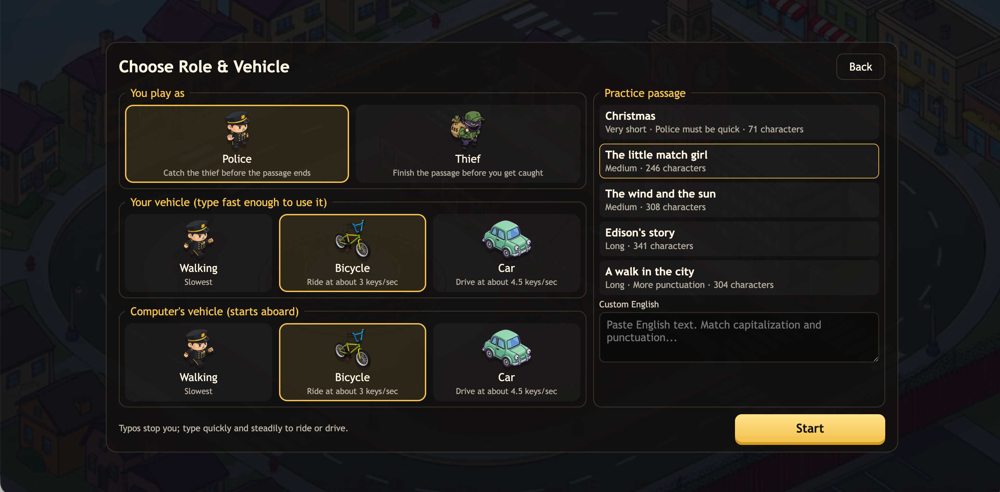
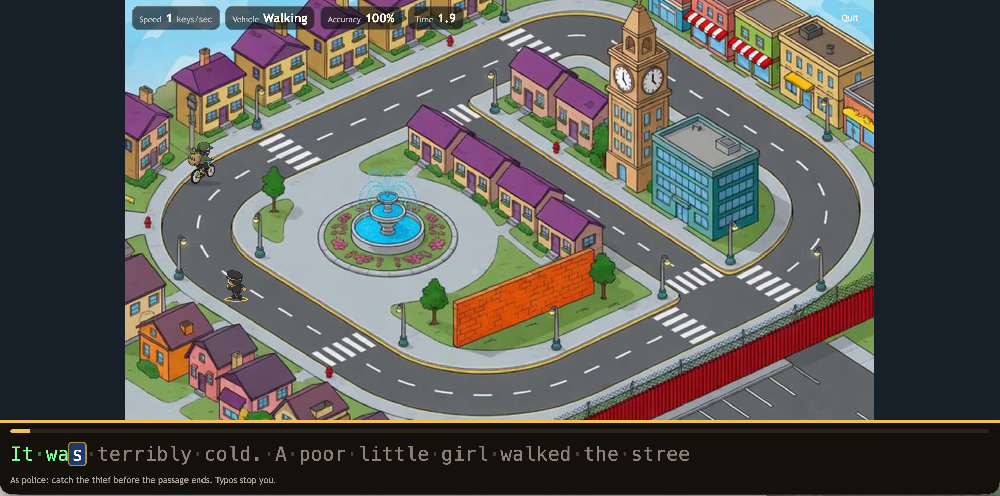
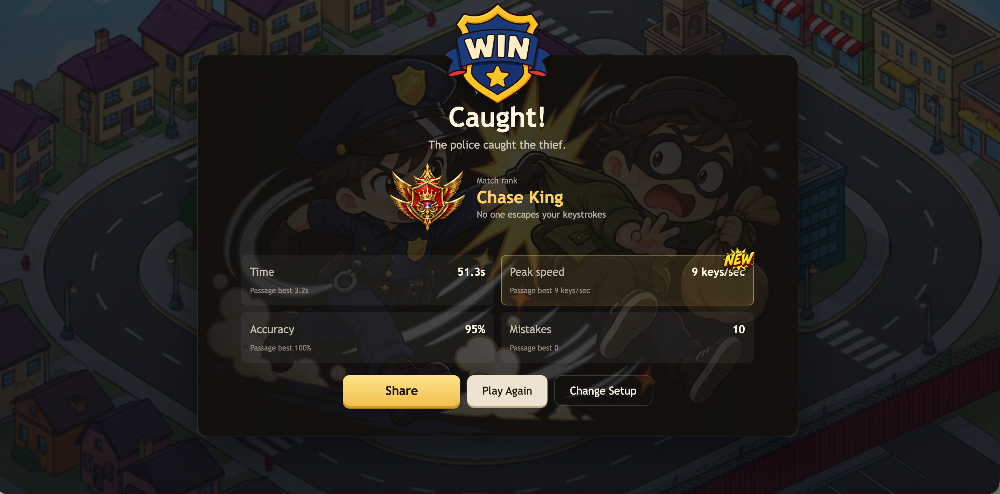

# 生死时速 / Speed Chase

金山打字通经典游戏「生死时速」的网页致敬版。在等距卡通城市中，通过看中文、输入拼音控制警察或小偷移动：打得越快，角色跑得越快，并会从步行升级到自行车或汽车。

**在线试玩：[https://typingchase.com](https://typingchase.com)**

## 游戏截图

### 选择角色、载具和练习文章



### 输入文字控制追逐速度



### 对局结果和段位



## 游戏特色

- 两种身份：扮演警察追捕小偷，或者扮演小偷完成文章并逃脱。
- 三种移动方式：步行、自行车和汽车，输入速度越高，移动速度越快。
- 默认中文拼音模式：粘贴自己的完整中文句子，自动生成无声调拼音。
- 汉字与对应拼音上下对齐，按字分组换行，当前汉字和拼音字母同步高亮；提示可以显示或隐藏，也保留英文原文练习模式。
- 转换在浏览器本地完成，不会把自定义句子发送到拼音 API。
- 实时统计速度、准确率、用时和错键数。
- 青铜、白银、黄金、钻石、王者五级对局段位。
- 保存个人最佳成绩，并在打破纪录时显示提示。
- 生成竖版战报海报，可保存或复制分享。
- 支持中文和英文界面。
- 首次进入时预加载地图和角色资源，慢速网络下不会在开局后等待图片。
- 重新绘制的 1672 × 941 PNG 城市背景采用清晰描边和卡通色块，与警察、小偷的风格更统一；游戏、选择界面和战报共用新背景。

背景资源为 `public/assets/map-clear.png`，保留原 `map.jpg` 作为旧素材。道路路径与角色尺寸不变：地图按真实图片尺寸适配画布，角色使用固定的 1280 宽逻辑场景比例，不会因背景分辨率增加而缩小。

## 游戏规则

1. 选择警察或小偷，以及双方使用的载具。
2. 选择中文拼音或英文模式，选择示例，也可以粘贴自己的句子（1–2000 字符）。自定义内容无效时会提示，不会偷偷切回示例。
3. 中文模式：切到英文输入法，按原文连续输入小写拼音，不打声调、空格或标点，`ü` 用 `v`。例如「你好，世界！」输入 `nihaoshijie`。夹杂的英文字母转小写，数字原样输入。
   提示中的拼音按字分隔（例如 `ni hao shi jie`），这些间隔仅帮助阅读，不需要输入空格；隐藏提示不会改变汉字位置；已经正确输入的拼音仍逐字母显示（包括当前字已输入的部分），未输入的字母继续隐藏，便于回看。
   英文模式：按照原文输入，大小写、空格和标点必须匹配。
   多音字采用词库结合上下文自动选择的读音，以显示的拼音为准；不支持的生僻字、表情和其他语言字符会提示替换。
4. 连续快速输入会提升移动速度；打错或停顿会让角色减速。
5. 扮演警察时，约 1 秒没有正确输入后，电脑小偷会在领先 1/4 圈时开始平滑减速，最远在半圈处停下等待。新的正确输入会让它平滑起步，但只会利用警察实际前进腾出的空间，始终不超过半圈；错键、长按和输入法组合键不会唤醒它。
6. 警察需要在文章结束前抓住小偷，小偷需要在被抓前完成全文；扮演小偷时的追逐规则不变。

游戏过程中按 `Esc` 可以退出当前对局。URL 加上 `?debug=1` 可以显示道路中心线，方便开发时调试路径。

## 技术栈

- TypeScript
- Vite
- Canvas 2D
- Web Audio API
- Cloudflare Workers Static Assets

## 本地开发

环境要求：Node.js 22.12 或更高版本。

```bash
npm ci
npm run dev
```

打开终端输出的本地地址即可开始游戏。

生产构建：

```bash
npm run build
```

使用 Cloudflare 本地运行环境预览：

```bash
npm run dev:cf
```

## 验证

```bash
npm test
npm run build
```

`npm test` 覆盖拼音转换、上下文多音字、`ü`、输入校验、原文与按键进度映射、英文回归和输入法事件，并用模拟 DOM 检查逐字分组、字母高亮、隐藏提示和整组滚动。追逐回归测试覆盖停顿减速、半圈等待、正确/错误输入恢复、慢速输入时的距离上限、跨圈和大时间步，以及小偷玩家模式的原有追逐行为。背景回归测试检查 PNG 尺寸、各页面的资源引用一致性、不同分辨率和画布比例下的场景缩放，以及角色与三种载具的绘制尺寸。浏览器中可检查：自定义短句、隐藏/显示提示、输错后继续、Esc 退出、再来一局、模式切换以及战报分享。

本分支保持单人电脑对手玩法；仓库中没有多人房间、实时联机服务器或 WebSocket 功能。

## 部署到 Cloudflare Workers

项目通过 `wrangler.jsonc` 配置 Cloudflare Workers Static Assets，构建产物位于 `dist`。首次部署前登录 Cloudflare：

```bash
npx wrangler login
```

构建并部署：

```bash
npm run deploy
```

当前配置会将 Worker 绑定到 [typingchase.com](https://typingchase.com)。如需使用其他域名，请修改 `wrangler.jsonc` 中的 `routes`。

### Cloudflare Git 自动部署

在 Cloudflare 控制台导入仓库并使用以下构建配置：

- Build command：`npm run build`
- Deploy command：`npx wrangler deploy`
- Root directory：`/`

Cloudflare 会根据仓库中的 `wrangler.jsonc` 上传 `dist` 静态资源。

## 项目结构

```text
public/             静态图片、图标和音频
src/                游戏逻辑、界面、音频和国际化代码
docs/screenshots/   README 游戏截图
index.html          页面结构与 SEO 信息
wrangler.jsonc      Cloudflare Workers 部署配置
```

## 说明

本项目是对经典打字游戏玩法的网页致敬实现，用于学习和交流。


### 新手难度

中文警察模式新增三档追逐难度，浏览器会记住选择：

- 入门（默认）：小偷静止等待，每个正确字母带来固定进度，按错不退步、不减速，无时间限制。每 4 个可输入汉字/字符为一小关，不拆拼音，标点不计数；抓到后点击“继续下一关”，继续原句剩余内容。最后不足 4 个字也独立完成。
- 练习：小偷为正常速度的 35%，按错不减速，仍保留半圈距离上限。
- 挑战：保留原版追逐与错误减速。英文模式和玩家当小偷仍使用挑战规则。

没有屏幕键盘或下一字母提示。默认隐藏拼音，用户可手动显示；隐藏时只显示已正确输入的字母。当前汉字突出、后续文字弱化，已经输入的内容保留以便回看。入门隐藏速度/时间 HUD，但结果中的用时与准确率仍作为练习记录，不是通关条件。不同难度的个人记录独立，原挑战记录不变。
